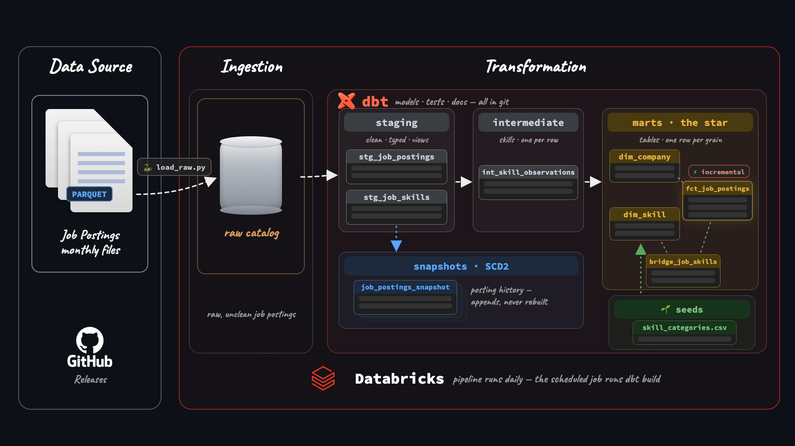
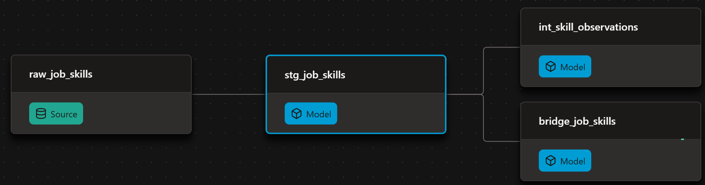

# Production Job Postings Pipeline (v2) - dbt + Databricks

A production dbt pipeline on **Databricks** over 843,097 raw job-posting scrapes, rebuilt nightly by a scheduled job with zero secrets.

- Shapes medallion layers into a tested star schema: 491,140 jobs at a declared grain
- Tracks a year of salary history with SCD2 snapshots: 504,591 version rows
- Loads incrementally and runs itself on a scheduled Databricks Job: no tokens anywhere

> **v2 of this pipeline.** [v1](https://github.com/rodgermeyers1971/dbt-duckdb-pipeline) built the foundations on DuckDB + GitHub Actions. v2 moves the same dataset to a real warehouse: Databricks, SCD2 history, incremental loads, a scheduled job.

| What I Built | How I Implemented | Where to Look |
| --- | --- | --- |
| **Star schema** | fact + dims + bridge on a declared grain | [`analytics/models/marts/`](analytics/models/marts/) |
| **SCD2 snapshots** | a year of salary history, backfilled | [`analytics/snapshots/`](analytics/snapshots/) + [`scripts/`](scripts/) |
| **Incremental fact** | merge on `job_id`, only new days load | [`fct_job_postings.sql`](analytics/models/marts/fct_job_postings.sql) |
| **Macros** | a custom parser + an overridden built-in | [`analytics/macros/`](analytics/macros/) |
| **Tests** | generic, singular, custom generic, and a unit test | [`analytics/tests/`](analytics/tests/) + the properties YAMLs |
| **Environments** | dev/prod as catalogs: dev from the laptop, prod only from the job | Unity Catalog: `dev` + `prod` |
| **Orchestration** | scheduled Databricks Job, zero secrets | Databricks → Jobs & Pipelines |
| **Analyses** | questions, kept next to the models that answer them | [`analytics/analyses/`](analytics/analyses/) |

---

## ⚙️ The dbt Pipeline

Raw scrapes flow through the medallion layers (raw, staging, intermediate, the star-schema marts) while snapshots capture history off staging. The lineage graph below is every model dbt builds:

And the dbt features doing the work:

| dbt Feature | How I Used It |
| --- | --- |
| Declared sources | `source('jobs', 'raw_job_postings')`, no hardcoded paths |
| Jinja beyond templating | benefits flags generated by a loop; one edit adds a flag |
| Custom macro | `parse_salary()`: one expression, written once, used four times |
| Installed package | `dbt_utils.get_column_values()`: the roles loop reads the data instead of a typed list |
| Overriding a built-in | `generate_schema_name`: schemas land where the folder says |
| Seeds | the skill taxonomy: version-controlled reference data |
| Test-driven cleaning | `not_null` surfaced 6,255 real id-less postings; dropped with eyes open, documented |
| Singular + custom tests | `assert_salaries_sane` caught 27 typed salary ceilings the schema tests never would |
| Unit test | `parse_salary` proven on fake rows before every build |
| SCD2 snapshots | `check` strategy on 13 content columns; `searched_at` dates the versions |
| Incremental | merge on `job_id`; `is_incremental()` + a `search_date` high-water filter |
| Environments | `dev` catalog from the local profile, `prod` catalog only from the scheduled job |

`dbt build` compiles SQL, materializes models, and fails the run if any test fails. Same command locally and in the scheduled job.

---

## 🚀 Production

**Databricks** owns the runtime: storage, compute, and the schedule, one platform.

- **Dev and prod as catalogs**: laptop builds land in the `dev` catalog; only the scheduled job writes the same schemas into `prod`
- **Scheduled Databricks Job** runs the whole pipeline nightly: `load_raw` (the ingest notebook), then `dbt deps` → `dbt debug` → `dbt build`, pulling the repo straight from GitHub
- **Zero secrets**: the job generates a temporary-credentials profile against the attached warehouse and revokes it after the run. No tokens in the repo, no CI secrets

Any BI tool connects straight to the warehouse: SQL editor, Excel, Power BI, and Tableau all query the `prod` catalog directly.

---

## 📸 Snapshots

The marts keep each job's **latest** scrape. The snapshot table keeps **every version**, SCD2 over 13 watched columns:

- **504,591** version rows across **491,140** jobs, **10,187** jobs with real change history
- **2,756** postings changed their salary between scrapes
- Analyses on top: [`top_posting_editors.sql`](analytics/analyses/top_posting_editors.sql) (Meta edits the most postings, 415) and [`salary_swings.sql`](analytics/analyses/salary_swings.sql) (a posting that went $60K to $1,000,000: snapshots catch typos mid-edit)

---

## 📖 Docs

Structure, tests, and column descriptions were written along the way. The docs site is a rendering of work already done:

**→ [YOU.github.io/REPO](https://YOU.github.io/REPO/)**

The site shows:

- The full **lineage graph** (raw, staging, intermediate, the star, the snapshot)
- **Model and column descriptions** from the YAMLs
- Which columns carry **tests**

The same descriptions live in the warehouse itself: `persist_docs` pushes them into Unity Catalog, so Catalog Explorer shows them right next to the data.

---

## 💻 Run it yourself

Prerequisites: a Databricks workspace (the [Free Edition](https://www.databricks.com/learn/free-edition) works) with the raw job-postings data loaded into a `raw` catalog. Then:

    uv sync
    cd analytics
    uv run dbt deps
    uv run dbt debug
    uv run dbt build
    uv run dbt snapshot

Backfill a year of snapshot history in one query: paste [`scripts/backfill_job_postings_snapshot.sql`](scripts/backfill_job_postings_snapshot.sql) into the SQL editor. `dbt snapshot` takes over seamlessly afterwards.

---

## 📁 Project layout

    .
    ├── analytics/
    │   ├── dbt_project.yml
    │   ├── models/                       # staging, intermediate, marts (the star)
    │   ├── snapshots/                    # SCD2: job_postings_snapshot
    │   ├── seeds/                        # the skill taxonomy
    │   ├── macros/                       # parse_salary + generate_schema_name
    │   ├── tests/                        # singular + custom generic
    │   └── analyses/                     # the questions
    ├── docs/                             # dbt docs site (GitHub Pages)
    ├── scripts/                          # load_raw.py (the job's ingest task) + snapshot backfill
    └── img/                              # README assets

---

*Built following the [dbt for Data Analytics & Engineering course](https://www.lukebarousse.com). Dataset: real job postings scraped daily, July 2025 to June 2026.*